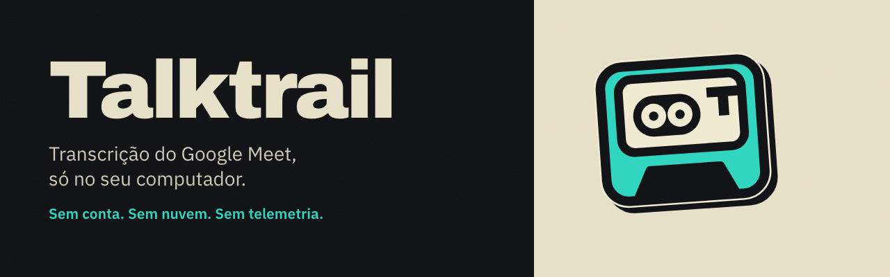
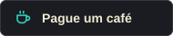

<p align="center"></p>

<p align="center">
  <a href="https://chromewebstore.google.com/detail/talktrail/jneejlpdlldinjnilghnndennbnpbeak"></a>
  <a href="https://buymeacoffee.com/talktrail"></a>
  <a href="https://github.com/lavinialencar/talktrail"></a>
</p>

# Talktrail


Transcrição e notas do Google Meet, **100% local**. Uma extensão para o navegador lê as legendas da reunião, mostra tudo num painel lateral e salva cada reunião como um arquivo Markdown na sua pasta. Nada vai para a nuvem, não há conta, não há telemetria.

- Oferece gravar quando você entra numa chamada e liga as legendas sozinha.
- Painel lateral com o texto ao vivo, **Notas** (o que sai da reunião) e **Pauta** (o que você leva antes; cada reunião tem a sua, com a lista de hoje vinda da tela inicial do Meet, o ícone contando quanto falta pra próxima reunião, e carrega sozinha ao entrar na sala; o painel abre em qualquer página, não só no Meet) com um editor markdown de verdade: título, lista, tarefa com caixa de marcar, hierarquia), **Marcadores** de momento e tags.
- **Pautas em arquivos, editáveis por IA:** com uma pasta escolhida, cada pauta também vira um `.md` em `Pautas/` (título e dia no cabeçalho, texto em Markdown). Edite o arquivo, à mão ou com uma IA, e a pauta muda no painel em até 1 minuto; o contrário também vale. Um `LEIA-ME.md` na pasta explica o formato.
- Um `.md` por reunião, com cabeçalho (título, tags, data, duração, participantes) e a transcrição por fala.
- Ao sair da chamada, para, salva e some sozinha.
- Avisa em vermelho se as legendas forem desligadas (sem elas não há transcrição).
- Engrenagem de ajustes em 5 blocos: perguntar, transcrever sozinho ou não fazer nada ao entrar; dois atalhos de teclado (Marcar momento e Transcrever/Parar); apagar reuniões antigas da biblioteca (nunca por padrão; ou 1, 7, 15, 30, 90 dias); aviso no chat do Meet (nunca, perguntar toda vez, sempre; experimental); salvar o chat da reunião (experimental); palavras que nunca devem ser gravadas.

## Como funciona

```
Meet (aba do navegador) → extensão → servidor local (127.0.0.1:8787) → arquivo .md na sua pasta
```

A extensão lê a caixa de legendas do próprio Meet. O servidor é um único arquivo Python (só biblioteca padrão) que escuta apenas em `127.0.0.1`, aceita só requisições com o cabeçalho `X-Talktrail` e grava na pasta que você escolher.

## Dois modos de guardar

| | Modo simples | Pasta ao vivo |
|---|---|---|
| Precisa instalar | Só a extensão | A extensão + o servidor (Python) |
| Onde ficam as reuniões | Na biblioteca da extensão e, ao terminar, em `Downloads/Talktrail/AAAA-MM/` | Numa pasta que você escolhe, atualizada a cada poucos segundos |
| Bom pra | Quem quer usar sem configurar nada | Quem integra com outras ferramentas (Obsidian, scripts, IA) |

A extensão escolhe sozinha: se o servidor responde, usa a pasta ao vivo; se não, usa o modo simples. A biblioteca guarda tudo nos dois.

## Instalar

Precisa de um navegador Chromium (Chrome, Brave, Edge, Helium...) e de Python 3.

**macOS, em dois passos:**

1. `python3 server/talktrail_server.py --instalar` liga o servidor (sobe sozinho com o computador) e abre a **página de configuração** no navegador. Ali você escolhe a pasta de destino.
2. Na mesma página, siga o passo 2: em `chrome://extensions` ligue o *Modo do desenvolvedor*, clique em *Carregar sem compactação* e escolha a pasta `extension/`.

**Instalar o complemento com um clique:** em Ajustes, Arquivos, "Instalar o complemento (pasta em Documentos)" baixa um zip com o instalador pro seu sistema (Mac, Windows ou Linux). Abrir o instalador instala o servidor, liga ele com o computador e passa a salvar em `Documentos/Talktrail`, sem escolher nada. O instalador avisa e abre o site do Python se ele faltar (no Windows tenta instalar sozinho pelo `winget`). A cópia do servidor que vai no zip fica em `extension/complemento/`; depois de mexer em `server/talktrail_server.py`, rode `npm run sincronizar` (o teste confere).

**Escolher uma pasta sem Python:** em Ajustes, "Escolher uma pasta…" usa o seletor do próprio navegador e a extensão grava nela ao vivo, numa subpasta por mês. De vez em quando o navegador pede pra liberar a pasta de novo (um clique, o painel avisa); enquanto isso a reunião vai pra Downloads, então nada se perde. Esse modo não tem "Mostrar na pasta" (o navegador não deixa).

**Windows:** o mais simples é **não instalar nada além da extensão**: o modo simples não precisa de Python e salva em `Downloads\Talktrail\AAAA-MM\`. Pra ter a pasta ao vivo, instale o Python 3 (python.org, marcando "Add python.exe to PATH") e rode `py server\talktrail_server.py --instalar`. Isso põe um atalho na pasta Inicializar e abre a página de configuração.

**Linux:** `python3 server/talktrail_server.py --instalar` cria `~/.config/autostart/talktrail.desktop` e abre a página de configuração. O seletor de pasta usa `zenity` ou `kdialog`, se houver.

**Atalhos de teclado:** no Mac são Option+Shift+M (marcar momento) e Option+Shift+T (transcrever/parar). No Windows e no Linux são Ctrl+Shift+K e Ctrl+Shift+Y, porque Alt+Shift+T já é do Chrome nesses sistemas. Se outra extensão já usa a combinação, o Ajustes mostra "sem atalho" e o botão "Mudar os atalhos" leva a `chrome://extensions/shortcuts`.

> Windows e Linux foram preparados e testados por simulação (comandos, arquivos de início, tentativas de gravar), mas ainda não numa máquina real. Se algo falhar, abra uma issue com o sistema e a mensagem.

Pronto: entre numa reunião do Meet, em aba normal, e clique em **Transcrever** no aviso. A primeira gravação pareia a extensão com o servidor sozinha.

Por padrão grava em `~/Documents/Talktrail/AAAA-MM/`. Pra outra pasta, use a página de configuração (ou `TALKTRAIL_OUT=/caminho python3 server/talktrail_server.py`).

## O arquivo gerado

```markdown
---
tipo: reuniao
titulo: "Planejamento do trimestre"
projeto: "Produto"
tags: ["Produto", "revisão"]
data: 2026-10-11
inicio: 20:58
duracao_min: 42
fonte: legendas-do-meet
participantes: ["Eu", "Ana"]
url: "https://meet.google.com/abc-defg-hij"
status: cru
---

## Resumo      ← para você (ou uma IA) preencher depois
## Pauta       ← o que você levou pra reunião
## Notas       ← o que saiu da reunião, em markdown
## Momentos marcados
## Transcrição
```

Nome do arquivo: `AAAA-MM/AAAA-MM-DD_HHhMM_titulo.md`. Se você muda o título durante a reunião, o arquivo é renomeado, não duplicado.

## Privacidade e uso responsável

- Tudo fica no seu computador. A extensão só tem acesso a `meet.google.com` e ao servidor local.
- Gravar e transcrever uma reunião pode exigir **o consentimento dos participantes** (e, no Brasil, observar a LGPD). Avise as pessoas antes de gravar.
- Quem decide o que gravar é você. Nos Ajustes dá pra listar palavras que nunca devem ser gravadas.
- O servidor só grava pra a extensão pareada (código secreto guardado fora da pasta das reuniões, só o dono lê), confere `Host` e `Origin`, e nunca sobrescreve o arquivo de outra reunião. Pra trocar de extensão: `python3 server/talktrail_server.py --parear`.

## Limites conhecidos

- A qualidade é a das legendas do Meet. O idioma das legendas precisa ser o da conversa; nomes técnicos saem errados com frequência.
- O Google muda a página do Meet de vez em quando. O ponto frágil é achar a caixa de legendas (`achaRegiao` e `legendasLigadas` em `extension/content.js`).
- Só funciona na aba normal do Meet, não no app instalado (PWA).
- "Mostrar na pasta" abre o arquivo selecionado no Finder e no Explorer; no Linux abre a pasta (não há jeito único de selecionar).

## Desenvolvimento

```
cd editor && npm i && npm run build     # gera extension/vendor/editor.js (CodeMirror 6)
cd test && npm i jsdom@24
node editor.js                           # bateria do editor (45 casos)
node fluxo.js                            # oferta → gravar → encerrar → sumir, num Meet simulado
node legendas.js                         # legenda desligada vira aviso
node desfazer.js                         # "Desfazer" continua a reunião; saiu da chamada não oferece
node extensao.js                         # entrada absurda: título, texto gigante, desempenho
python3 servidor.py                      # entrada hostil contra o servidor (emoji, RTL, colisão, tipos errados, senha)
node ajustes.js                          # engrenagem: oferta, palavras bloqueadas, aviso e leitura do chat
node experiencia.js                      # computador dormindo, motivo da legenda, diagnóstico
node modo-simples.js                     # sem servidor: biblioteca e Downloads
node md.js                               # o .md do navegador é idêntico ao do servidor
```

Para ver o painel num navegador comum, com o Chrome simulado: sirva a pasta do projeto (`python3 -m http.server 8799`) e abra `test/panel-demo.html?tema=claro|escuro&aba=notas&legenda=off`.

A extensão se recarrega sozinha quando os arquivos mudam (o servidor informa uma "versão" em `/extversao`), e nunca no meio de uma gravação.

## Créditos e licenças de terceiros

- [CodeMirror 6](https://codemirror.net) (MIT), o editor das Notas e da Pauta.
- [GSAP](https://gsap.com) (licença gratuita da GreenSock), as animações.
- [Inter](https://rsms.me/inter/) (SIL Open Font License), a fonte do painel.


## Publicar na loja

```bash
npm test                 # suíte completa, inclui o teste do pacote
npm run empacotar        # gera dist/talktrail-<versão>.zip, sem instalador nem recarga de desenvolvimento
```

O manifest do repositório leva `version_name` com "dev": é isso que liga a recarga automática e o instalador embutido. O pacote da loja remove os dois. Arte e texto da listagem: `store/`. Privacidade: [PRIVACIDADE.md](PRIVACIDADE.md). Licença: MIT ([LICENSE](LICENSE)); componentes de terceiros em [AVISOS-DE-TERCEIROS.md](AVISOS-DE-TERCEIROS.md).
